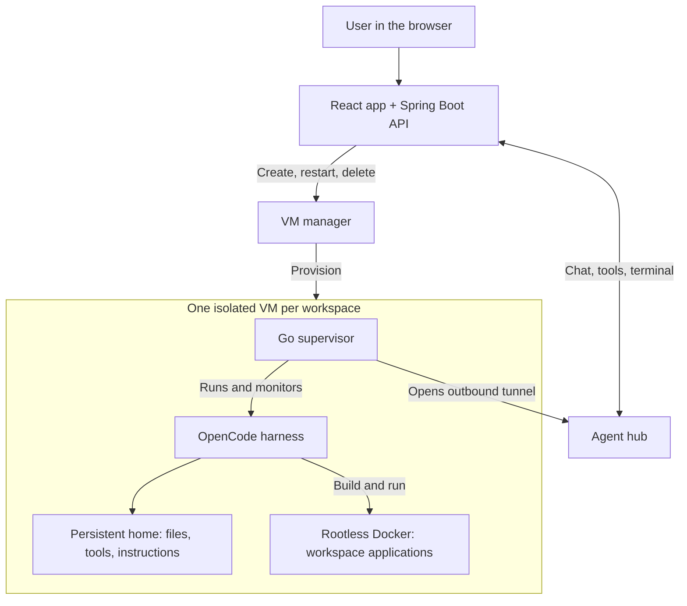
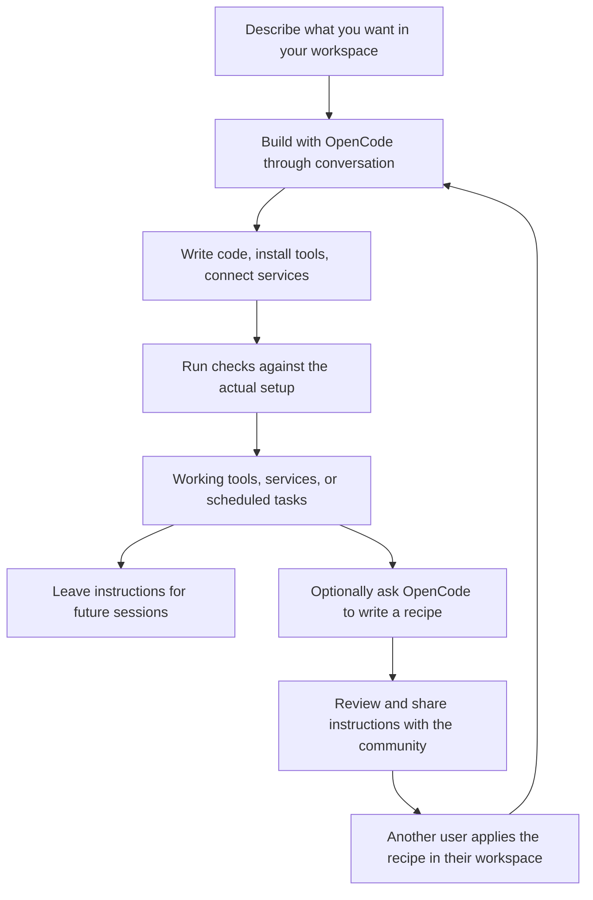
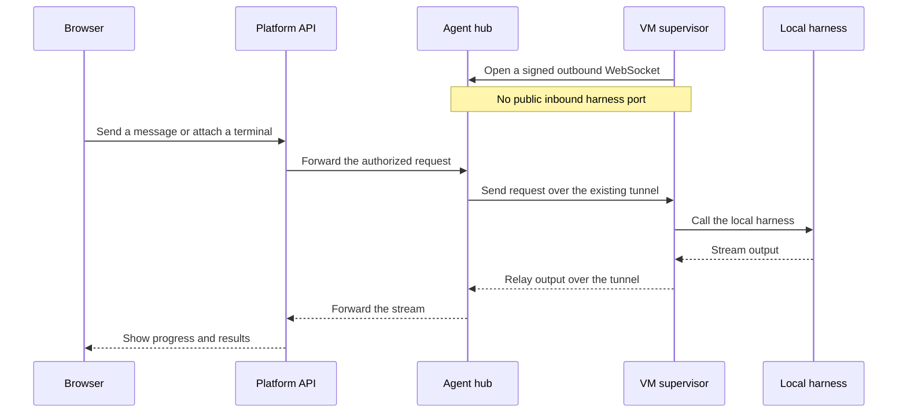

### Why I built it

I kept finding small things I wanted to automate: checking information, working with email and calendars, running a script regularly, or putting a small application online. Each task was manageable. Setting up the tools, connecting accounts, and remembering how everything worked was the part I kept repeating.

workspaced-ai grew out of that frustration. I wanted to open a workspace, describe what I needed to OpenCode, and build it there through conversation. The files, tools, and services stay in that workspace for the next session. When someone builds something useful, they can turn the setup into instructions and share them so other people can build it in their own workspaces.

The philosophy is simple: give the agent a useful environment, keep its work within a clear boundary, and turn the things it learns into reusable instructions.

### A workspace is a machine that can do the work

Each workspace gets its own isolated virtual machine. Inside it, a container runs OpenCode, the agent harness that handles conversations, tools, and terminal sessions. The agent can write code, install packages, configure integrations, and build and run applications through the VM's rootless Docker daemon.

The browser is where I talk to it and inspect the result. Chat streams the agent's progress, a terminal gives me direct access when I need it, and settings expose secrets, instructions, MCP servers, and scheduled tasks. Models connect through OpenRouter using the user's own key.

The VM boundary separates one workspace from another and from the platform's management services. The harness has access to the rootless Docker socket for its applications; the system Docker socket belongs to the supervisor. Files and configuration under the workspace home survive harness restarts. Deleting the workspace deletes its VM and disk too.

### Build in your workspace, then share what worked

The main flow starts with the user and OpenCode. You describe what you want, and the agent builds it inside your workspace: installing tools, writing code, connecting services, and checking the result. You can keep asking for changes as the setup takes shape.

Recipes let the community share what worked. A recipe is a set of Markdown instructions that explains how to recreate a useful setup: what to install, which secrets are needed, how to configure it, and how to check it. After building something, you can ask the agent to write those steps down for others.

Someone else can choose that recipe from the store and apply it in their own workspace. This starts a session with the instructions, and OpenCode carries out the setup there. One example is a shared browser: the agent can work on a website, hand control to the user when needed, and continue in the same browser afterward. Other recipes can help set up a recurring task or connect a domain to an application the user built.

I like this approach because someone else's experience becomes a useful starting point. I can read their instructions, have OpenCode follow them, and adapt the result to my needs. A good recipe also leaves maintenance instructions, so a later session knows what exists and how to use it.

The store supports public and private recipes, categories, search, and ratings. The agent can write a draft from work it has just completed, and the user reviews and imports it. Published recipes are immutable: an update becomes a new recipe, so a rating still refers to the instructions someone actually tried.

### An agent that can build its own integrations

MCP, the Model Context Protocol, gives the agent tools for working with external systems. A workspace can use an existing local or remote MCP server, but it can also build one when an integration is missing.

The shared-browser recipe is a concrete example. It guides OpenCode through setting up Chromium in Docker, controlling it with Playwright, and building a local MCP server that exposes browser tools. The recipe includes checks and instructions for future sessions, so the browser becomes something the workspace can keep using.

Imagine asking the agent to collect information from a website where you have an account. It opens the site in the workspace's browser. When it needs you to sign in or choose an account, it pauses automation and gives you a temporary link to that same browser. You complete the step and hand control back. The agent checks the result, removes temporary desktop access, and continues with the existing browser session.

That is the kind of experience I want people to share through recipes: useful instructions for building a capability in their own workspace. The shared-browser recipe keeps the browser private during normal automation and opens temporary viewer access only for the handoff. That access is separate from the private agent harness; the recipe's current viewer connection uses HTTP and is unencrypted.

Credentials go through workspace secrets, backed by Vault, and MCP configuration refers to environment variables. Recipes instruct the agent to ask for missing credentials through settings rather than putting them in the conversation. For recurring work, the workspace's task CLI schedules a prompt to run in a new session; the prompt can use the same tools and instructions. Tasks run while the workspace is running.

### Reaching the harness without opening it to the internet

The harness has no public inbound port. The supervisor starts the connection from inside the VM, opening authenticated WebSocket workers to the agent hub. The platform sends chat, tool, and terminal traffic back through those existing connections.

It follows the same outbound-connection idea as a reverse shell, implemented here as a structured tunnel for HTTP requests, streaming responses, and WebSockets. The browser still goes through the platform's authentication and workspace access checks.

Enrollment uses a single-use token. After that, the supervisor signs its requests with an Ed25519 key that stays on the VM. It also applies the local harness password itself, so that password does not cross the tunnel.

Public applications are a separate decision. The agent can run an application in Docker and request a firewall change when the user wants to publish it. Opening an application port does not expose the harness or its terminal.

### Connecting a domain

A useful automation sometimes becomes a small website or service. I want the same AI session to handle that transition: configure the application, connect a domain, and check that the public address works.

The project includes a GoDaddy recipe that equips the agent with the official CLI, uses a scoped credential from workspace secrets, and guides DNS and HTTPS configuration for a domain the user already owns. It inspects existing DNS records first and verifies the result before calling the connection complete. Domain setup belongs alongside the application setup, with the harness remaining private.

### The technology behind it

| Part                   | Technologies and purpose                                                                         |
| ---------------------- | ------------------------------------------------------------------------------------------------ |
| Browser application    | React, TypeScript, Vite, and Tailwind CSS; streaming chat, settings, and an xterm.js terminal    |
| Platform services      | Java 25 and Spring Boot; separate API, VM manager, and agent hub                                 |
| Workspace runtime      | Isolated VMs, a Go supervisor, and an Alpine-based OpenCode harness                              |
| Applications and tools | Rootless Docker and Compose, Node.js, Python, shell tools, and local or remote MCP servers       |
| State and secrets      | PostgreSQL, JPA, Flyway migrations, and HashiCorp Vault                                          |
| Authentication         | Auth0 sign-in with Spring Security and an HttpOnly session cookie                                |
| Billing                | Stripe Checkout, payment webhooks, invoices, and a prepaid balance charged for workspace runtime |
| Communication          | Server-sent events for live updates and WebSockets for terminals and outbound VM tunnels         |

Auth0 handles sign-in, while Stripe handles payments. Keeping those responsibilities with dedicated services lets me focus on the part I wanted to build: the workspace lifecycle, the agent's working environment, and the instructions that make a useful setup repeatable.

### What I am trying to make easier

I want to spend less time rebuilding the surroundings of a task. A user should be able to build what they need with OpenCode in their own isolated workspace and keep using it. When that work could help someone else, a community recipe passes on the instructions so they can build it too.

[Explore workspaced-ai](https://workspaced.online/) · [Read the source](https://github.com/kalpak44/workspaced-ai)
